## Featured projects

- **[concurrent-http-server](https://github.com/zemen14/concurrent-http-server)** —
  An HTTP/1.1 web server written from raw sockets in C: a thread pool with
  a bounded work queue, 128 striped per-file locks, strict request parsing,
  and a thread-safe audit log. Builds clean under `-Wall -Wextra -Werror`
  and passes live GET/PUT/error-path tests.
- **[air-mouse](https://github.com/zemen14/air-mouse)** —
  A tilt-controlled Bluetooth mouse: an ESP32-C3 reads an ICM-42670
  accelerometer over I2C and turns hand tilt into cursor movement, with
  two-tier sensitivity and pointer acceleration. Wave your hand, move
  the cursor.
- **[cloud-weather-station](https://github.com/zemen14/cloud-weather-station)** —
  A networked weather system: ESP32-C3 firmware and a Python server loop
  location and live weather between the device, the server, and a weather
  API, with real CRC-checked SHTC3 sensor readings.
- **[micro-weather-station](https://github.com/zemen14/micro-weather-station)** —
  A pocket weather station built from bare silicon up: an SHTC3 sensor and
  an RGB LCD running on one shared I2C bus, with register-level display
  code and no libraries doing the heavy lifting.
- **[lightlink](https://github.com/zemen14/lightlink)** —
  Text messages sent over a beam of light: a Raspberry Pi blinks Morse code
  on an LED, an ESP32-C3 reads it with a light sensor and reconstructs the
  message with a timing state machine — now with startup self-calibration.
- **[sonic-ruler](https://github.com/zemen14/sonic-ruler)** —
  An ultrasonic range finder that corrects itself — it adjusts the speed of
  sound for live temperature and reports the median of 9 samples so one
  bad echo can't corrupt the reading.

Also here: an SHTC3 sensor driver, WiFi weather/telemetry nodes for
ESP32-C3, a Wordle solver and a Wordle game in C, a customer database on a
hand-written hash table, a line-based text editor with unit tests, a postfix
stack calculator, and a string-utilities library.

## Skills

C, C++, Java, Python — ESP-IDF / ESP32, Arduino, FPGA (Basys 3, Vivado),
POSIX sockets & pthreads, Git, Linux.

## Background

- **AgentCheck** — a multi-agent hiring pipeline (Python, FastAPI) built on
  a 3-person team — placed **Top 20 of 330+ participants** at Agent Forge
  2026 (Sunnyvale). My fork: [Agent-Forge-AI-Hackathon](https://github.com/zemen14/Agent-Forge-AI-Hackathon)
  — I worked on browser automation, the data pipeline, and frontend
  integration.
- Combat Robotics & Humanoid Teams at Slugworks (UCSC): mechanical design,
  firmware development, and electronics.
- Member, National Society of Black Engineers; Management Leadership for
  Tomorrow Career Prep fellow (CP 2027).

## Contact

- LinkedIn: linkedin.com/in/zemen-bariagabr-36b9a5227
- Email: zemenbariagabr@gmail.com
